<h1 align="center">PointDetector</h1>

<p align="center">
  Find the closest food banks and places that give help, see at a glance which of them are open right now,
  and know what to bring before you go.
</p>

<p align="center">
  <a href="https://github.com/yuriisurzhykov/PointDetector/actions/workflows/release_build_github.yaml"></a>
  <a href="LICENCE.txt"></a>
  
  
  <a href="https://play.google.com/store/apps/details?id=com.yuriisurzhykov.pointdetector"></a>
</p>

<p align="center">
  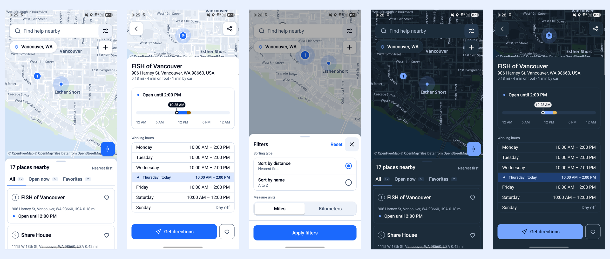
</p>

## What the app does

PointDetector shows the places around you on a map and in a list, sorted by distance. Every place tells you
what matters when you are on your way: is it open **now**, when does it close or open next, whether you need
an appointment or documents, and how long it takes to get there.

<p align="center">
  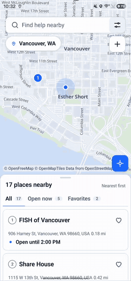
  <br>
  <sub>The same walk as a video: <a href="docs/media/promo-light.mp4">light theme</a> · <a href="docs/media/promo-dark.mp4">dark theme</a></sub>
</p>

### Features

- **Map and list.** A free map (OpenStreetMap data, no keys, no limits) with a three-stop bottom sheet that holds
  the cards. The tabs are *All*, *Open now* and *Favorites*; the order is by distance or by name, in miles or in
  kilometers.
- **Open or closed, honestly.** Every card has a status: open until, closing soon, opens today, closed until, or
  *hours not specified* when the data has no answer. The app never invents an answer.
- **A place on a day axis.** The place screen has the hours of the whole week and a day axis you can drag to see
  the status at any time of the day. How to get help is a separate block (appointment, documents), shown only for
  the facts that are known.
- **Route, share and favorites.** One tap opens the route in the navigation app of your choice; the heart keeps a
  place in *Favorites*.
- **Your city, automatic or chosen.** The city is detected by the location or picked from a list that is read from
  the cloud. The cache is shown first and the cloud answer follows, so the app works offline with what it already
  knows and syncs every time it comes to the front.
- **Add a place.** Three steps: find the address, fill in the name, the working hours and how to get help, and
  done. Places that you added are stored on the phone and can be deleted from the place screen.
- **Day and night.** The light and the dark theme (the map follows it too) and three languages: English, Russian
  and Ukrainian.

## Screenshots

<table>
  <tr>
    <th>Light</th>
    <th>Dark</th>
  </tr>
  <tr>
    <td>
      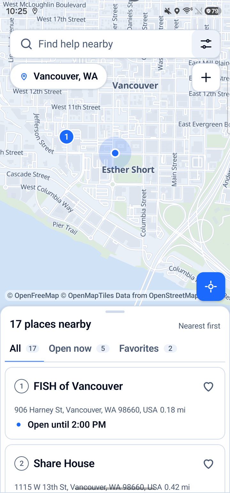
      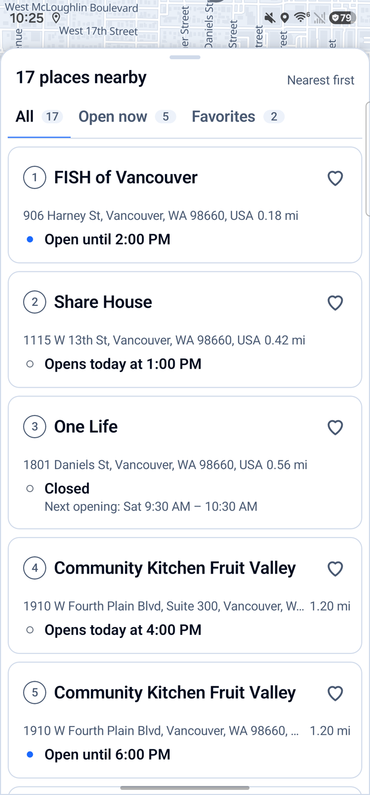
      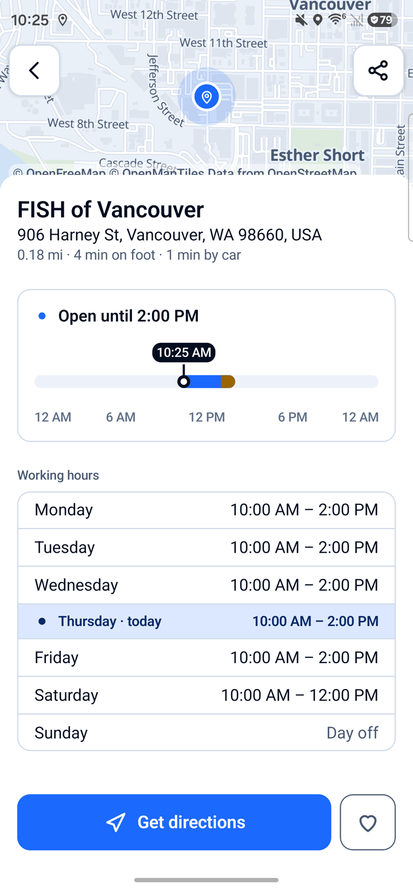
      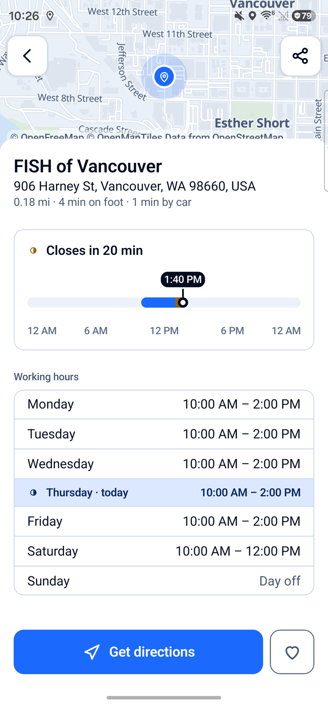
    </td>
    <td>
      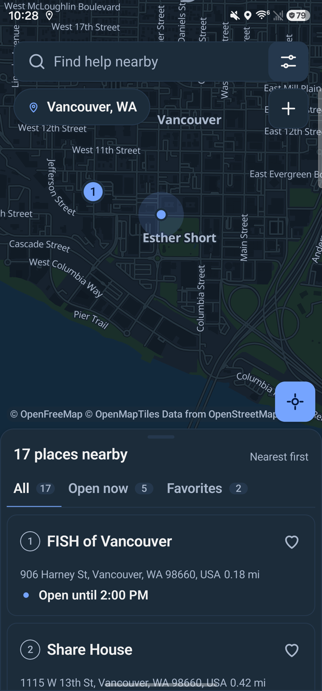
      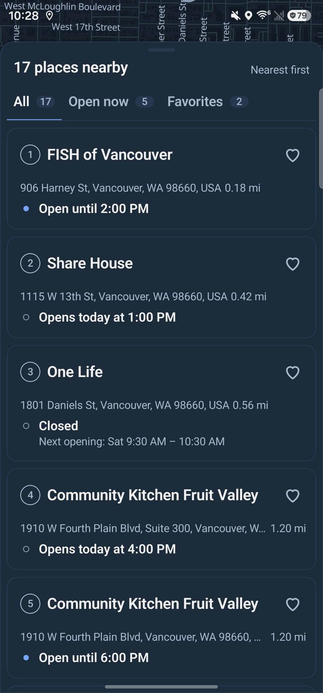
      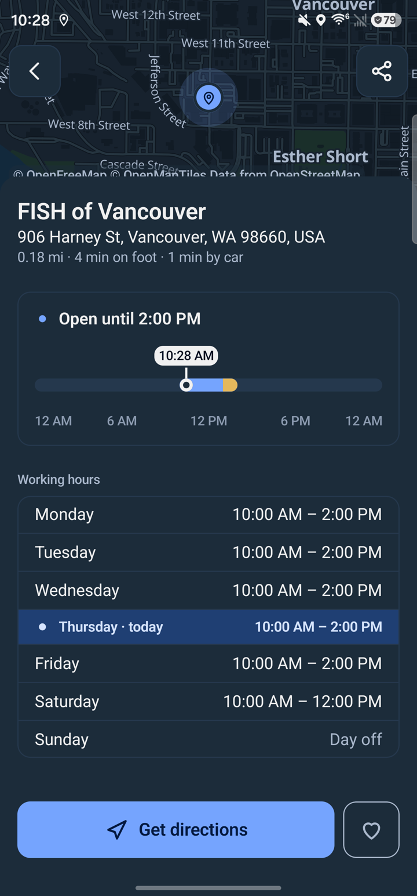
      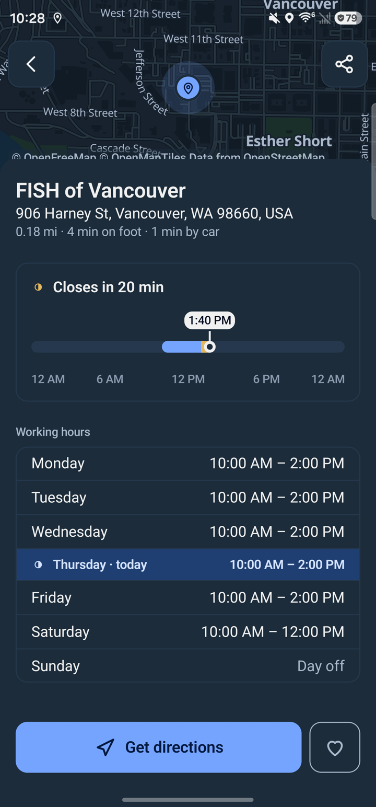
    </td>
  </tr>
  <tr>
    <td>
      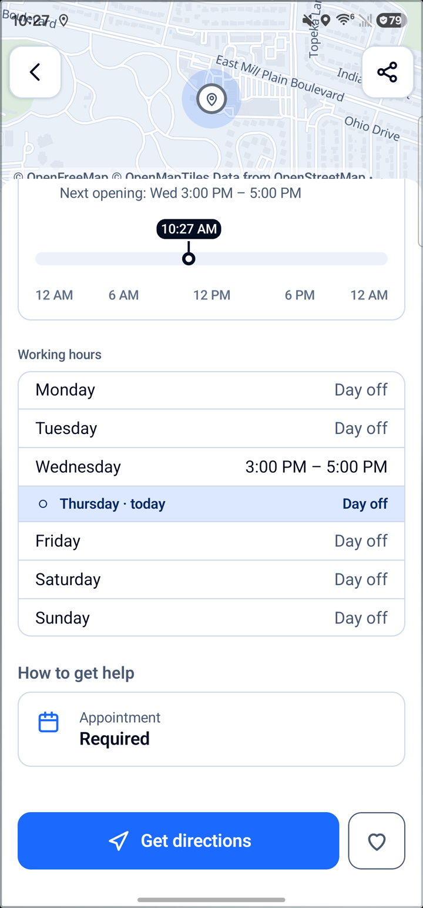
      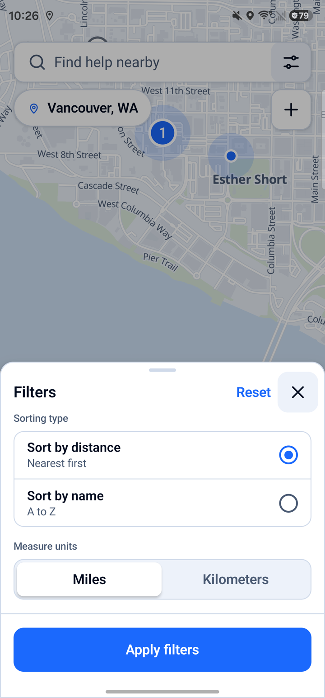
      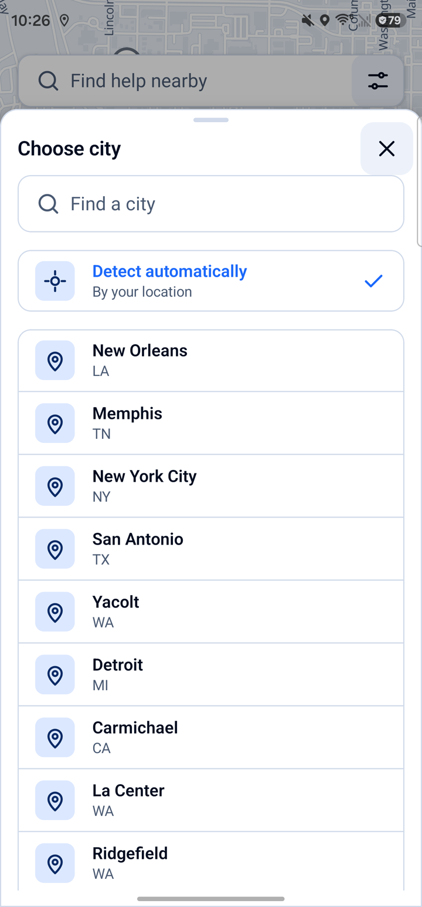
      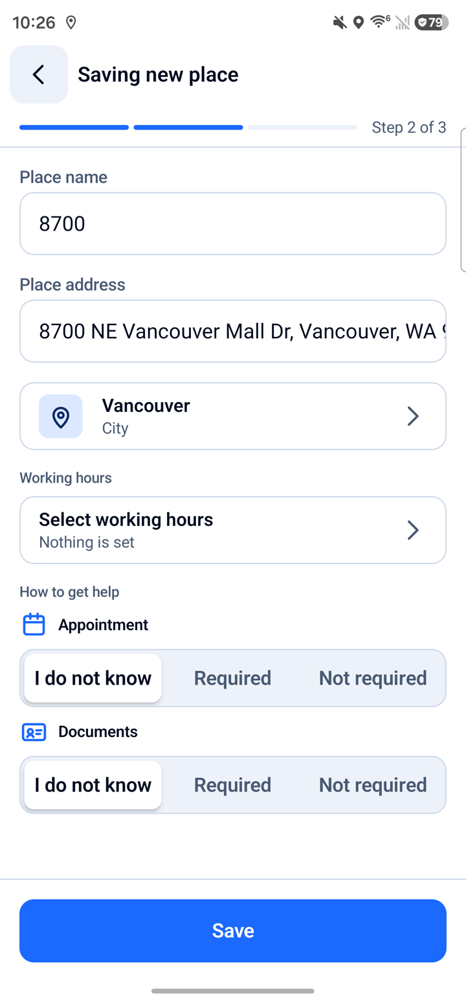
    </td>
    <td>
      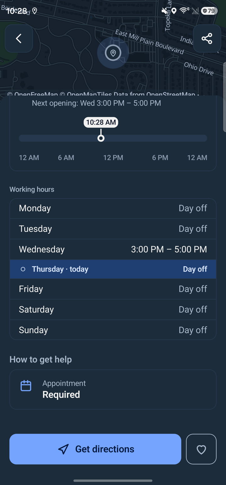
      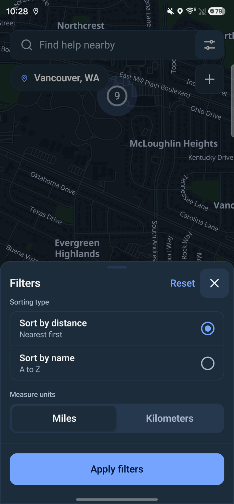
      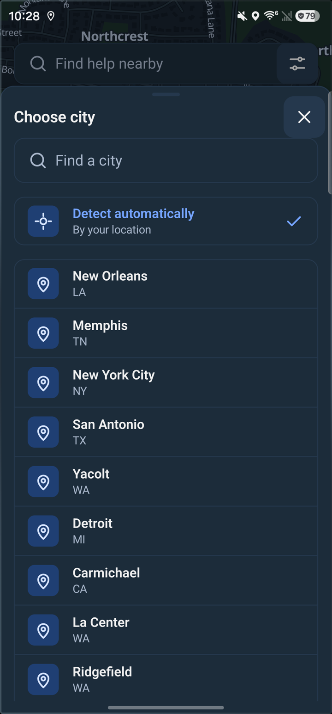
      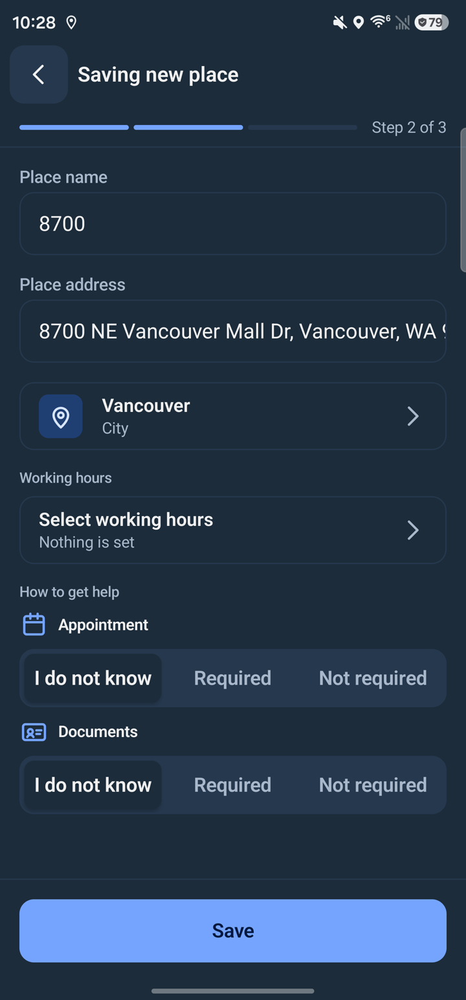
    </td>
  </tr>
</table>

The screenshots are from a phone with the debug build; the full-size files are in
[`docs/media`](docs/media).

## Tech stack

| Area | What is used |
| --- | --- |
| Language, UI | Kotlin, Jetpack Compose on its own design system (no Material), edge-to-edge, one `MainActivity` |
| Architecture | Clean + MVVM: `core`, `data`, `domain`, `presentation`; a screen is a `*Screen` over plain state, a `*Route` that connects the view models and a mapper that turns state into components |
| Dependency injection | Hilt |
| Local data | Room (the cache of cities and points, favorites and the places of the user) |
| Cloud data | Firebase Realtime Database, the format is described in [`foodbanks/firebase/README.md`](foodbanks/firebase/README.md); Firebase Crashlytics |
| Map | MapLibre over OpenFreeMap vector tiles, behind the `PdMap` / `PdMapFactory` contract |
| Asynchrony | Kotlin Coroutines and Flow |
| Tests | JUnit, coroutines-test, [Konsist](https://docs.konsist.lemonappdev.com) for the architecture rules |
| Build, CI | Gradle 9.4, JDK 21, `minSdk` 26, `targetSdk` 37, GitHub Actions, [git-cliff](https://git-cliff.org) |

## Architecture

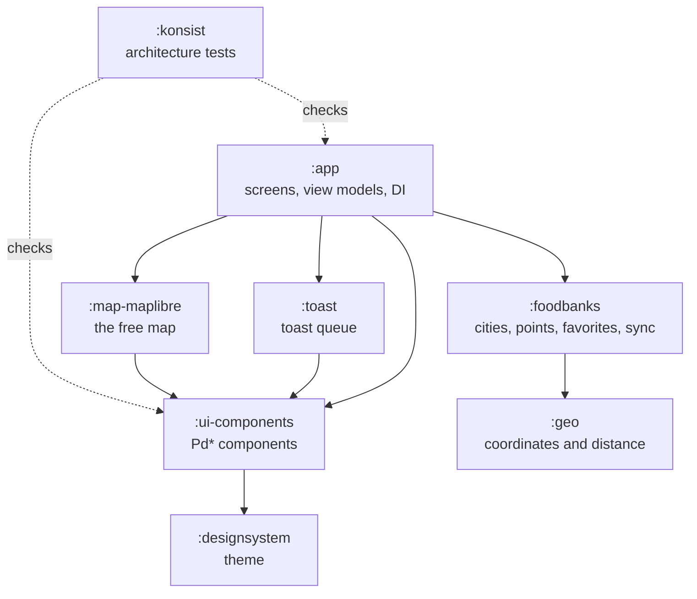

- **`:app`**: the application. `presentation` holds the screens by feature (the map with the list, the place, adding
  a place, the city, the filters, the permissions), `domain` the use cases, the hours logic and the app messages,
  `data` the Room cache and the repositories.
- **`:foodbanks`**: the data of cities and points with its own database: the cloud and cache synchronization, the
  favorites and the places of the user.
- **`:designsystem`** and **`:ui-components`**: the theme and every component, in atomic design (atoms, molecules,
  organisms). The rules of the components (an interface per component, no nullable structures in a public API,
  no hardcoded sizes or colors, texts and graphics through resolvers) are checked by **`:konsist`**, and the build
  fails when they are broken.
- **`:map-maplibre`**: one implementation of the map contract. Screens know only the contract, so another map can
  be plugged in by one module and one binding in `di/MapModule.kt`.
- **`:toast`**: a priority queue of toasts as a state machine; the app posts plain messages that are turned into
  toasts in one place.

More details for contributors are in [`CLAUDE.md`](CLAUDE.md).

## Build and run

You need JDK 21 and the Android SDK. The map does not need any keys.

```bash
./gradlew assembleDebug            # the debug APK, the application id gets the .dev suffix
./gradlew testDebugUnitTest        # unit tests of all modules
./gradlew :konsist:test            # the architecture rules
```

Local files that the build reads (they are git-ignored):

- `app/signing.properties` and `app/keystore.jks`: the build reads `signing.properties` while it configures the
  project, so even a debug build needs the file. For local work it can hold any values.
- `app/version.properties`: the fallback version; the `VERSION_CODE` and `VERSION_NAME` environment variables
  override it.
- `app/google-services.json` is tracked, so Firebase works out of the box.

## Releases

A release is made by a tag. Push a tag such as `v1.2.3` and [GitHub Actions](.github/workflows/release_build_github.yaml)
builds the signed APK and AAB, creates the GitHub release and attaches both files with the changelog. The signing key
lives only in the secrets of the repository.

Commits follow [Conventional Commits](https://www.conventionalcommits.org) (`feat(app): ...`, `fix(ui-components): ...`);
the check runs as a git hook (`git config core.hooksPath .githooks`) and in CI. The release notes are generated from
them by git-cliff, grouped by type.

## License

[MIT](LICENCE.txt) © 2023 Yurii Surzhykov
